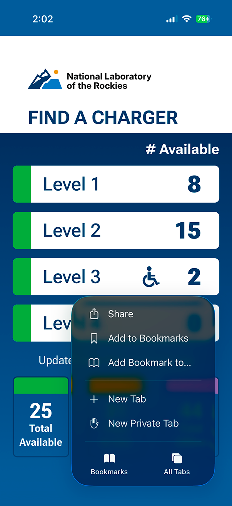
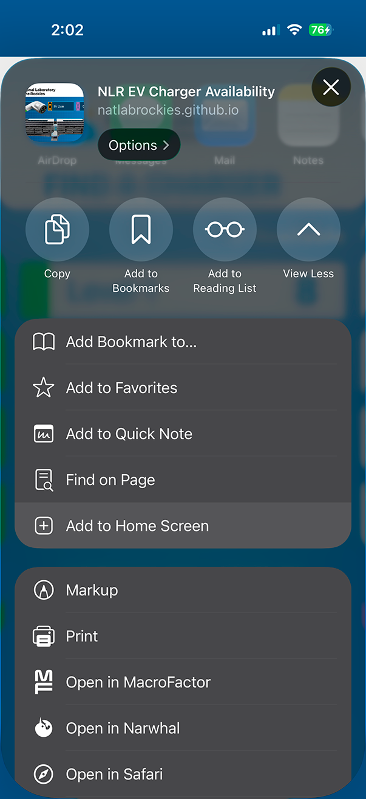
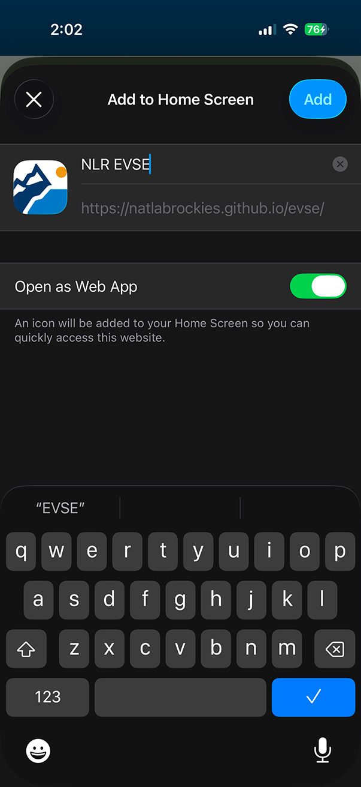
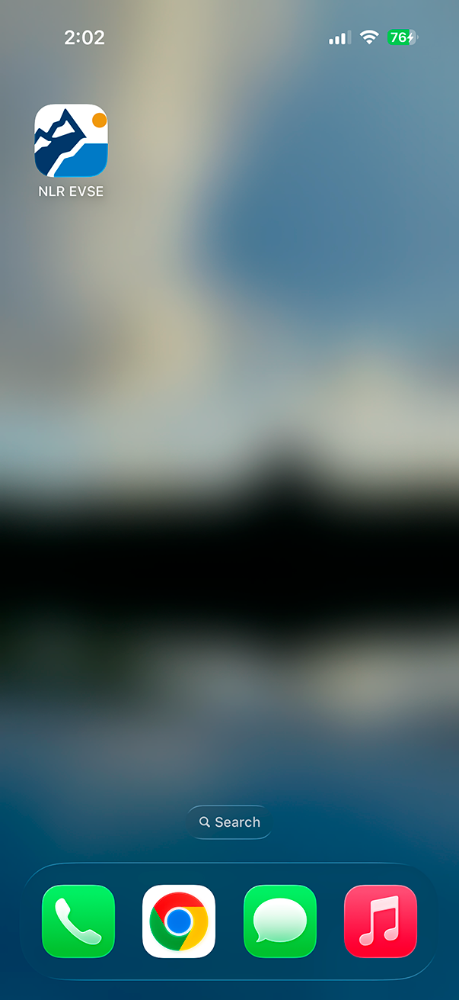
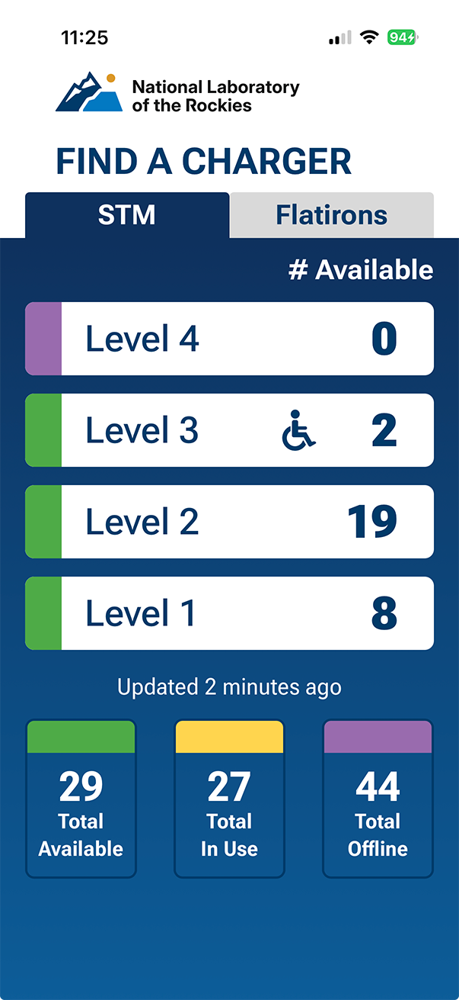

# NLR EVSE Dashboard

Real-time EV charger availability for the National Laboratory of the Rockies' South Table
Mountain (STM) and Flatirons campuses.

## Run

Run the Angular interface at `http://localhost:4200`:

```shell
pnpm install
pnpm start
```

## Functionality

The Angular 22/Tailwind 4 interface:

- Loads live EVSE data from S3 every 60 seconds and immediately when the app regains focus,
  keeping the last good data on screen if a refresh fails.
- Remembers the selected STM or Flatirons campus and summarizes available, in-use, and offline
  chargers, with keyboard-accessible campus tabs built on Angular Aria.
- Provides responsive space and map views for STM garage levels 1–4 and the Flatirons lot,
  including accessible charging and elapsed charging time.
- Supports installation as an iOS web app and caches application assets with a service worker.

## Development

```shell
pnpm format
pnpm lint
pnpm test
pnpm build
```

### Storybook

Each component has stories next to it (`*.stories.ts`) for its visual states. They get their
data from the `EvseAvailabilityService` test stub, not from S3. Browse them at
`http://localhost:6006`:

```shell
pnpm storybook
```

`pnpm build-storybook` builds a static copy into `dist/storybook`. Stories that set a viewport,
such as the portrait map page, shrink to fit a short browser window, so give the preview enough
room to see them at full size.

### Visual and accessibility tests

`pnpm test-storybook` runs every story in headless Chromium with Vitest. Each story's play
function and axe accessibility check must pass, and its screenshot must match its reference in
`.storybook/screenshots/<platform>/`. Text renders slightly differently on each operating system,
so only the Linux references that CI uses are committed.

Install Playwright's Chromium, then create local references for your platform:

```shell
pnpm exec playwright install chromium
pnpm test-storybook --update
```

Git ignores local references, so they are your own baseline. To see what a change does to the
stories, create references on `main` with `--update`, make the change, and run
`pnpm test-storybook`. Vitest writes the reference, actual, and diff images of each mismatch to
`.vitest-attachments/`. A story without a reference fails once while Vitest writes one.

The **Storybook visual tests** workflow runs the tests on Linux for every pull request and push to
`main`. When screenshots don't match, its `storybook-screenshots` artifact holds the actual and
diff images. To create the Linux references or to accept a change on purpose, run the workflow
manually on your branch with **Update the Linux reference screenshots** checked. Then download
its `storybook-screenshots` artifact and commit the `.storybook/screenshots/linux/` folder from
it.

## Add to the iOS Home Screen

1. Open the dashboard in Safari and tap **Share**.

   

2. Tap **Add to Home Screen**.

   

3. Leave **Open as Web App** enabled and tap **Add**.

   

4. Open **NLR EVSE** from the Home Screen.

   

   
