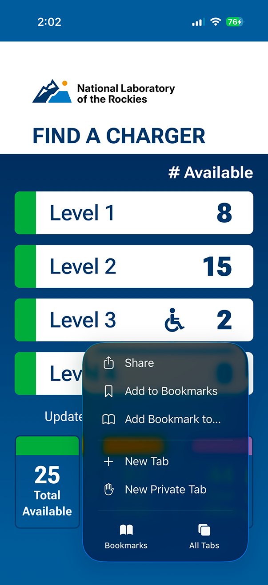
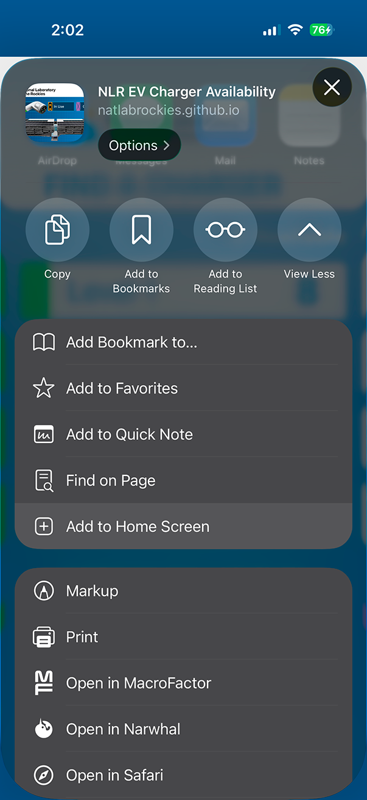
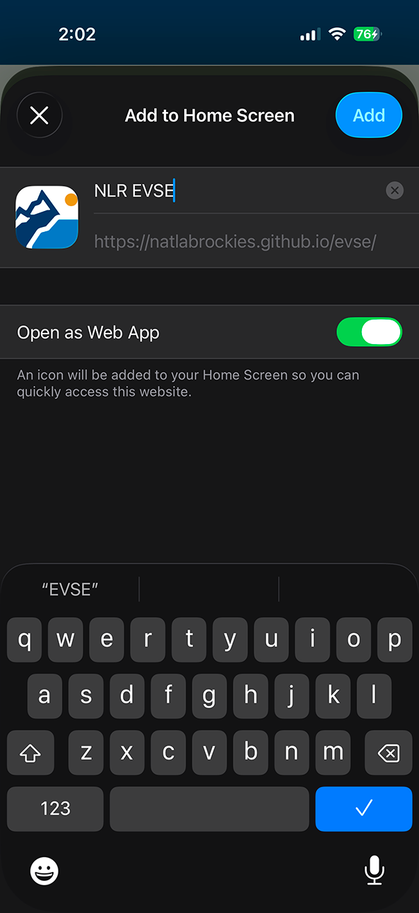
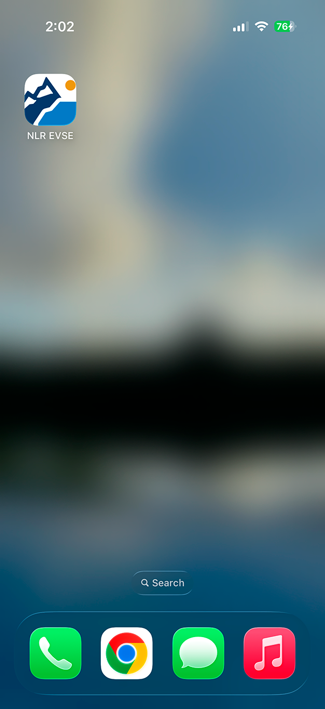
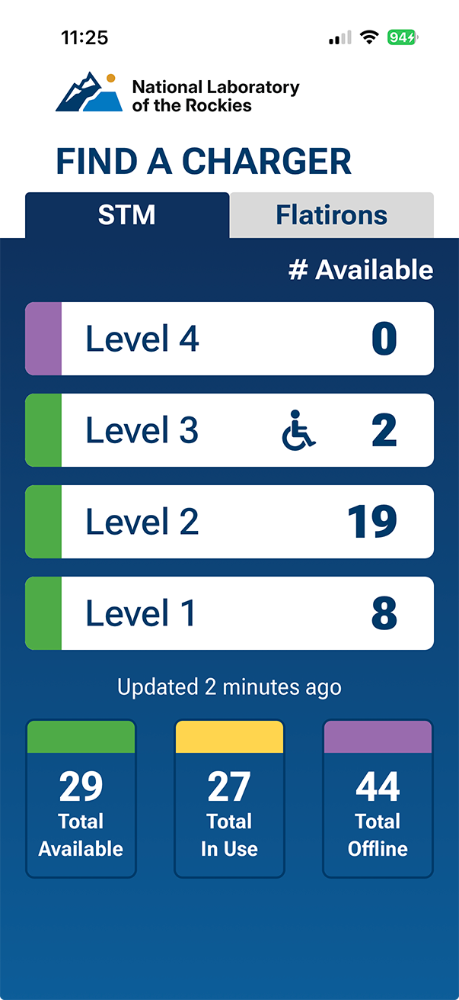

# NLR EVSE Dashboard

Real-time EV charger availability for the National Laboratory of the Rockies' South Table
Mountain (STM) and Flatirons campuses.

## Run

Run the Angular interface at `http://localhost:4200`:

```shell
pnpm install
pnpm start
```

## Functionality

The Angular 22/Tailwind 4 interface:

- Loads live EVSE data from S3 every 60 seconds and immediately when the app regains focus,
  keeping the last good data on screen if a refresh fails.
- Remembers the selected STM or Flatirons campus and summarizes available, in-use, and offline
  chargers, with keyboard-accessible campus tabs built on Angular Aria.
- Provides responsive space and map views for STM garage levels 1–4 and the Flatirons lot,
  including accessible charging and elapsed charging time.
- Supports installation as an iOS web app and caches application assets with a service worker.
- Shows an embedded view, without its own branding, when another page such as the
  [NLR EV charging page](https://www.nlr.gov/about/ev-charging-stations) frames it.

## Development

```shell
pnpm format
pnpm lint
pnpm test
pnpm build
```

### Deployment builds

| Environment | Command              | Site URL                                                            | Output directory                         |
| ----------- | -------------------- | ------------------------------------------------------------------- | ---------------------------------------- |
| Production  | `pnpm build`         | `https://widgets.nlr.gov/intelligent-campus/evse/`                  | `dist/evse-dashboard/production/browser` |
| Staging     | `pnpm build:staging` | `https://widgets-stage.tada-stage.nlr.gov/intelligent-campus/evse/` | `dist/evse-dashboard/staging/browser`    |

Both builds use `/intelligent-campus/evse/` as the base path and generate absolute canonical and
social-preview URLs before service-worker hashing. Staging is public, so its build also adds
`<meta name="robots" content="noindex">` to keep it out of search results; never deploy the
staging output to production. Serve the chosen output directory at that path. Local development
stays at `/`. CI tests and builds both environments and uploads the `evse-dashboard` artifact;
deployment is handled separately.

The server in front of each site must:

- Answer any path under `/intelligent-campus/evse/` that has no file extension, such as
  `level/2` or `fc/map`, with `index.html` and status 200, without redirecting to add a trailing
  slash. Shared links and reloads then open the right page. Missing files that have an extension
  still return 404.
- Send `Cache-Control: no-cache` with every response that serves `index.html`, including the
  fallback above, and with `ngsw.json`. Visitors without the service worker, such as every
  embedded copy, then load the current version rather than a cached page.
- Let www.nlr.gov frame the dashboard: send neither `X-Frame-Options: DENY` or `SAMEORIGIN` nor a
  `frame-ancestors` policy that leaves it out.

Other files can be cached as immutable. The bundles, fonts, garage maps, and logo have a content
hash in their names, and browsers check `ngsw-worker.js` for updates without their cache. The
icons, `favicon.svg`, and `og-image.png` in `public/` keep fixed names, so rename one when it
changes and update `src/index.html`, `public/manifest.webmanifest`, and `ngsw-config.json`.
When deploying, upload the new build's other files before `index.html` and `ngsw.json`, and keep
the previous build's hashed files for a while, so visitors still on it don't get 404s.

### Embedding

Inside another page's iframe, the dashboard shows an embedded view. It starts at the campus tabs,
fills the frame, adds no entries to the embedding page's history, and doesn't register its service
worker. Add `?embed=1` or `?embed=0` to the URL to preview either view in a browser tab. To embed
it, for example above **Cost and Payment** on the EV charging page:

```html
<iframe
  src="https://widgets.nlr.gov/intelligent-campus/evse/"
  title="Live EV charger availability at NLR's campuses"
  loading="lazy"
  style="
    display: block;
    width: 100%;
    height: 47rem;
    height: max(clamp(41rem, 100svh, 47rem), min(47rem, (100vw - 40rem) * 100));
    margin: 0 0 1.5rem;
    border: 0;
  "
></iframe>
```

The frame fills the column. On screens 40rem (640px) wide and up it is 47rem (752px) tall, which
fits the home page without scrolling inside the frame and keeps the level pages out of their
short-landscape layout. On narrower screens, which are phones, it matches the visible screen
height but stays between 41rem and 47rem. Nothing scrolls inside the frame, and most phones show
all of it at once; on short ones such as the iPhone SE, the page scrolls a little to show the rest.
The first `height` is a fallback for browsers without `svh` units. Keep the `title`: screen
readers announce it for the frame.

### Storybook

Each component has stories next to it (`*.stories.ts`) for its visual states. They get their
data from the `EvseAvailabilityService` test stub, not from S3. Browse them at
`http://localhost:6006`:

```shell
pnpm storybook
```

`pnpm build-storybook` builds a static copy into `dist/storybook`. Stories that set a viewport,
such as the portrait map page, shrink to fit a short browser window, so give the preview enough
room to see them at full size.

### Visual and accessibility tests

`pnpm test-storybook` runs every story in headless Chromium with Vitest. Each story's play
function and axe accessibility check must pass, and its screenshot must match its reference in
`.storybook/screenshots/<platform>/`. Text renders slightly differently on each operating system,
so only the Linux references that CI uses are committed.

Install Playwright's Chromium, then create local references for your platform:

```shell
pnpm exec playwright install chromium
pnpm test-storybook --update
```

Git ignores local references, so they are your own baseline. To see what a change does to the
stories, create references on `main` with `--update`, make the change, and run
`pnpm test-storybook`. Vitest writes the reference, actual, and diff images of each mismatch to
`.vitest-attachments/`. A story without a reference fails once while Vitest writes one.

The **Storybook visual tests** workflow runs the tests on Linux for every pull request and push to
`main`. When screenshots don't match, its `storybook-screenshots` artifact holds the actual and
diff images. To create the Linux references or to accept a change on purpose, run the workflow
manually on your branch with **Update the Linux reference screenshots** checked. Then download
its `storybook-screenshots` artifact and commit the `.storybook/screenshots/linux/` folder from
it.

## Add to the iOS Home Screen

1. Open the dashboard in Safari and tap **Share**.

   

2. Tap **Add to Home Screen**.

   

3. Leave **Open as Web App** enabled and tap **Add**.

   

4. Open **NLR EVSE** from the Home Screen.

   

   
